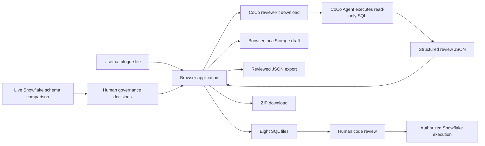

# Architecture and security

## Architecture

Governance Script Studio is a static browser application with a dependency-free Node build step for deploy-time SEO and security output.

There is no application server, API, runtime database or Snowflake connector.

## Components

| Component | Responsibility |
|---|---|
| `index.html` | Accessible seven-step workflow and download UI |
| `styles.css` | Responsive visual design |
| `app.js` | Catalogue parsing, state, validation, SQL rendering, local drafts, import/export and ZIP encoding |
| `data/catalog.json` | Legacy/sample normalized catalogue; not loaded automatically |
| `scripts/build.mjs` | Creates `dist`, injects canonical URLs, generates sitemap/robots/header rules and separates production from preview indexing |
| `netlify.toml` | Netlify build command, publish directory and deploy-context indexing policy |

## Data flow

1. The user selects a catalogue file and the browser parses it in memory.
2. The selected table initializes a browser-local configuration.
3. User decisions update in-memory state and `localStorage`.
4. Optionally, the browser renders an autonomous CoCo task; CoCo executes its read-only SQL plan and the browser imports the returned JSON as unapproved recommendations.
5. Export serializes the reviewed state as JSON.
6. Generation renders SQL strings in memory.
7. Downloads use browser `Blob` URLs.
8. ZIP creation uses a local, uncompressed ZIP encoder.

## Network behavior

The page loads the pinned SheetJS browser build from the official SheetJS CDN to parse spreadsheet files. Catalogue contents, configurations, table names, and decisions are not sent to that CDN or to GitHub, Netlify, OpenAI, Snowflake, or an analytics service. Normalized JSON import does not require the spreadsheet parser.

The optional CoCo workflow uses a file handoff controlled by the user. After receiving the task, CoCo performs the Snowflake evidence collection without a human relaying queries or results. The browser does not initiate or observe the CoCo session.

Netlify naturally receives standard web-server request metadata when serving the static site. No analytics integration is included.

## Stored browser data

Drafts are stored under table-specific `localStorage` keys. This is convenient but not a governance evidence store.

- Drafts remain on the device/browser profile.
- Clearing site data deletes them.
- Other scripts running on the same origin could read them.
- Do not enter credentials, PII values or secrets.
- Export reviewed JSON and store it in the approved repository/workflow.

## Trust boundaries

### Catalogue facts

Catalogue fields are untrusted snapshots until compared with the live schema. The application HTML-escapes catalogue values before displaying them.

### Human decisions

Human input is trusted only after review. The application provides structural validation, not business approval.

### CoCo recommendations

Imported CoCo JSON is untrusted automation output. The importer binds it to the selected table and contract version, whitelists evidence and tag fields, accepts only bounded aggregate expressions, records warnings and resets every human confirmation. It can prefill review fields but cannot satisfy approval gates.

### Generated SQL

Generated SQL crosses the largest trust boundary: it is intended for privileged execution. The application escapes SQL string literals and normalizes one-line comments. Role names and row-policy names are validated as identifiers.

Two inputs intentionally permit SQL expressions:

- `baseline.extra_aggregates` in imported JSON;
- de-identification acceptance expressions.

These exist because aggregate logic is table-specific. Treat them as source code and review them accordingly.

## Policy limitations

The frontend assumes existing shared objects consistent with the runbook pattern:

- `GOVERNANCE.TAGS.GDF_PII`
- `GOVERNANCE.TAGS.CDE`
- `GOVERNANCE.TAGS.PII_DERIVED`
- source/layer/retention tags
- `GDF_MASK_STRING`, `GDF_MASK_DATE`, `GDF_MASK_TS`, `GDF_MASK_NUMBER`, `GDF_MASK_FLOAT`

The frontend does not inspect these policy bodies. A tag on an unsupported type, such as Boolean or Variant when no matching policy exists, does not provide masking. The UI blocks the five known shared masking tiers on unsupported types.

## Privileged commands

Generated scripts may contain:

- `USE ROLE ACCOUNTADMIN`
- grants on tables or the account
- tag assignments
- DMF creation and attachment
- row-access policy attachment
- comments visible to metadata consumers

Generation is not authorization. Execute only through approved change management.

## Security headers

The build-generated `dist/_headers` currently sets:

- a strict Content Security Policy with an exact JSON-LD hash and the pinned SheetJS CDN allowlisted;
- `Strict-Transport-Security`;
- `X-Content-Type-Options: nosniff`
- `X-Frame-Options: DENY` and `frame-ancestors 'none'`;
- `Referrer-Policy: strict-origin-when-cross-origin`;
- restrictive permissions for camera, microphone, geolocation, payments and USB;
- `Cross-Origin-Opener-Policy: same-origin`;
- cache controls by asset type;
- `X-Robots-Tag: noindex` for deploy previews and documentation files.

## Secrets

This repository requires no secrets. Do not configure Snowflake passwords, API keys or personal access tokens as frontend environment variables; frontend variables are public to visitors.

## Dependency posture

The application runtime uses browser APIs and the pinned SheetJS browser build. The Node build and tests use only standard-library modules and install no runtime packages. Browser compatibility should still be tested after changes to APIs such as `Blob`, `TextEncoder`, `localStorage` or clipboard access.
